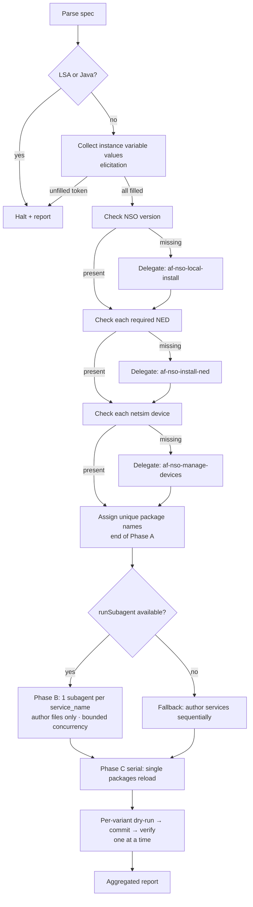

# Orchestration Flow — delegation order and validation loop

The orchestrator sequences existing skills. It owns **sequencing and
gap-detection**; each delegated skill owns its own procedure and scripts.

## Order of operations

Execution is phased: **serial setup → parallel authoring → serial reintegration**.
Environment-global and NSO-global steps stay serial; only per-service authoring
is parallel. See [subagent-fanout.md](./subagent-fanout.md) for the fan-out
contract.

```
Phase A (serial):  parse ─> guardrails ─> collect vars ─> reconcile env ─> name packages
                     (1)        (2)           (3)             (4)
Phase B (parallel): fan out 1 subagent per service_name ─> author files only
                     (5)
Phase C (serial):  packages reload ─> per-variant validate ─> report
                     (6)                                       (7)
```



## Instance variable elicitation (Step 3, before build)

`raw_configuration` uses angle-bracket placeholders (`<vrf-name>`) declared in
each variant's `instance_variables`. Concrete values are collected up front
(elicitation-first) because placeholders are not valid device config for
`load-native-config`.

| Comment marker | Collection |
|---|---|
| `shared across variants` | one value, reused across variants |
| (none) | one value per variant |

Rules:
- Map each key to its **literal** token in `raw_configuration`; preserve source
  typos (e.g. `intergace_type_and_id` → `<intergace-type-and-id>`).
- Every `<...>` token must get a non-empty value or the variant halts.
- Credential variables (e.g. `password`) are prompted only, never persisted or
  echoed; if no real value, use a flagged throwaway for the netsim dry-run.
- Substitute values → concrete config handed to the build; keep
  key → token → value so tokens become YANG leaves (shared → service-level,
  per-instance → per-endpoint).

## Reconciliation is idempotent (check-then-act)

| Requirement | Check command | Delegate on gap |
|---|---|---|
| NSO version | `ncs --version` | `af-nso-local-install` |
| NED `(type,version)` | `show packages package <ned>` | `af-nso-install-ned` |
| Netsim device | `show devices list` | `af-nso-manage-devices` (create → load → fetch-keys → sync-from) |

Rules:
- Check first; act only on a miss. Never re-install/re-create satisfied items.
- Iterate every distinct NED slug (multi-NED comma lists, e.g.
  `cisco-iosxr,cisco-nx`).
- CLI checks (NED/device) require NSO running. If NSO is stopped and the version
  was already satisfied, halt and report — do **not** auto-start NSO. (Only the
  `af-nso-local-install` delegation may start NSO.)

## Authoring + validation (split across phases)

Authoring and validation are split: **authoring** (parallel, per service) and
**validation** (serial, top level).

**Phase B — authoring subagent** (one per `service_name`), for each variant,
delegates to [af-nso-manage-package](../../af-nso-manage-package/SKILL.md)
service-from-config for file work only:

1. Scaffold + write YANG/template/Python + `make` build from the concrete config.
2. Return a structured result (packages authored, per-variant status, errors).
   It does **not** reload, commit, or validate.

**Phase C — serial reintegration** (top-level agent only):

1. A single `packages reload` after all authoring completes.
2. Per variant, one at a time: **dry-run → commit → verify**:
   - `commit dry-run outformat native` must be **non-empty and correct**.
   - Empty/incorrect dry-run = validation failure for that variant.
3. Any `load-native-config` / live-NED template generation happens here (serial),
   not in an authoring subagent.
4. Variant isolation: on failure, record `subtype`, package name, and log
   pointer, then continue with the next variant.

Relevant logs on failure:
- `~/nso-run-*/logs/ncs-python-vm-<pkg>.log`
- `~/nso-run-*/logs/ncserr.log`

## What this skill does NOT do

- It does not author YANG/templates directly — that is service-from-config's job.
- It does not source device credentials/secrets — inherited from the delegated
  skills (e.g. NED auto-download uses the macOS Keychain via `af-nso-install-ned`).
- It does not honor literal `management_ip` values from the spec — netsim assigns
  addressing.
- It does not support LSA topology or Java callbacks in v1.
