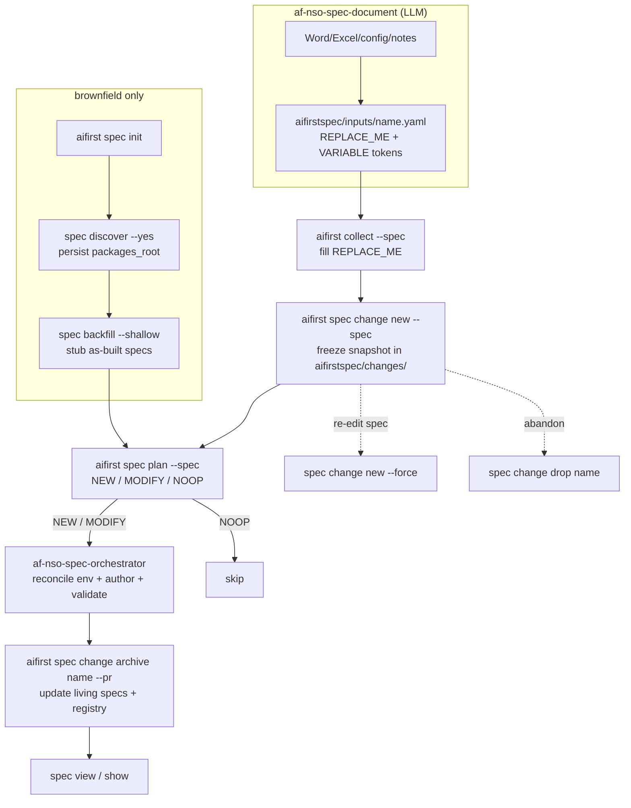

# Spec-Driven Service Build — end-to-end flow

How a requirements document becomes validated NSO packages, and how the
`aifirstspec/` package-memory store ties the stages together. This spans three
skills plus the deterministic `aifirst` CLI:

| Stage | Owner | Output |
|---|---|---|
| Elicit a design when the user has no source material | **af-nso-service-requirements** (LLM Q&A) | requirements doc + per-role config templates |
| Author a spec from raw requirements | **af-nso-spec-document** (LLM) | `aifirstspec/inputs/<name>.yaml` |
| Fill missing non-variable fields | **`aifirst collect`** (CLI) | same file, `REPLACE_ME` resolved |
| Register the spec into memory (at build start) | **af-nso-spec-orchestrator** → `aifirst spec change new` | frozen `spec-snapshot.yaml` in the store |
| Plan + build + validate | **af-nso-spec-orchestrator** + delegated skills | packages under `packages/<id>/` |
| Record the outcome | **af-nso-spec-orchestrator** → `aifirst spec change archive` | living specs + registry updated |

> The CLI is deterministic and LLM-free; the skills are the LLM parts. Spec
> **generation** (parsing Word/Excel/config) cannot live in the binary, which is
> why it stays in `af-nso-spec-document`. Everything durable and deterministic —
> identity, snapshots, planning, registry — lives in `aifirst spec`.

---

## Greenfield: from requirements to packages

1. **Author** — `af-nso-spec-document` reads the source (Word/Excel/config/notes),
   detects `<VARIABLE>` tokens, and writes a YAML skeleton to
   `aifirstspec/inputs/<name>.yaml` (after `aifirst spec init`). Unknown
   non-variable fields become `REPLACE_ME`; `<VARIABLE>` tokens are preserved.
   *No source material?* **af-nso-service-requirements** runs first (structured
   Q&A) to elicit the design and emit a requirements doc + per-role config for
   spec-document to author from.
2. **Fill** — `aifirst collect --spec aifirstspec/inputs/<name>.yaml` opens a
   one-shot browser form and writes real values back in place. `<VARIABLE>`
   tokens and secrets never enter the form.
3. **Human review gate (mandatory)** — **stop** and have the human review/edit
   `aifirstspec/inputs/<name>.yaml` and **explicitly confirm** before any build.
   An earlier generic "go ahead" does not count. `af-nso-spec-document` ends here;
   the build stages below run only after approval.
4. **Register** (owned by the orchestrator, at build start) —
   `aifirst spec change new --spec aifirstspec/inputs/<name>.yaml` freezes an
   immutable `spec-snapshot.yaml` (plus `proposal.md`, `tasks.md`) under
   `aifirstspec/changes/<date>-<service-slug>/`, covering **all variants in one
   change**. Only instance-variable *keys* are recorded — never secret values.
   `af-nso-spec-document` does **not** run this — it stops at `inputs/`, so the
   change lifecycle has a single owner.
5. **Plan** — `aifirst spec plan --spec <file>` emits `NEW` / `MODIFY` / `NOOP`
   per package as JSON.
6. **Build** — `af-nso-spec-orchestrator` reconciles the environment (NSO, NEDs,
   netsim) and authors + validates one package per variant, delegating to
   `af-nso-local-install`, `af-nso-install-ned`, `af-nso-manage-devices`, and
   `af-nso-manage-package`.
7. **Archive** — on a green, published build, **one**
   `aifirst spec change archive <service> --pr <url> --status deployed` updates
   every covered package's living `specs/<id>/spec.md` and its
   `packages-registry.md` row, then moves the change to `changes/archive/`.

## Brownfield: adopt a repo that already has packages

Run **before** the register/plan steps so `plan` can tell `MODIFY` from `NEW`:

```bash
aifirst spec init                 # scaffold the store (idempotent)
aifirst spec discover --yes       # find package-meta-data.xml, persist packages_root
aifirst spec backfill --shallow   # seed stub as-built specs (provenance: backfilled, confidence: low)
aifirst spec view                 # confirm what was recorded
```

`backfill --shallow` is deterministic and structure-only — it cannot understand
what a package *does*. To replace a `confidence: low` stub with a real,
LLM-authored as-built understanding, run the **af-nso-deep-backfill** skill,
which reads the YANG/templates/Python and commits the reconstruction with
`aifirst spec backfill --deep` (registry row → `provenance: deep-backfilled`,
confidence off `low`, plus a real `<!-- aifirst:as-built -->` machine block so
`plan` computes true deltas). A build that touches a stub does this on demand;
you can also run it standalone, one package at a time, right after adoption.

---

## Store layout the flow produces

```
aifirstspec/
  inputs/<name>.yaml              # agent-authored working input (step 1–2)
  changes/<date>-<slug>/          # spec-snapshot.yaml + proposal.md + tasks.md (step 3)
  changes/archive/                # closed changes (step 6)
  specs/<id>/spec.md              # living as-built truth (step 6 / backfill)
  packages-registry.md            # index: id → service/variant → status → change → PR
  config.yaml                     # detected packages_root
```

---

## Lifecycle diagram



---

## Guarantees and gotchas

- **One change per build, not per package.** `aifirst spec change new` covers
  every variant in the spec and allows only one active change per name; do not
  loop it per package. Archive once with the change name.
- **Authoritative command surface is the live CLI.** `aifirst spec` and
  `aifirst spec change` print current usage; treat that as source of truth over
  any snapshot in the skills. Do not copy the CLI's `docs/spec-commands.md` into
  a skill.
- **Secrets never persist.** `collect` never renders secret fields; snapshots
  record instance-variable keys only.
- **Graceful degradation.** If the installed CLI lacks `aifirst spec`, read
  `aifirstspec/packages-registry.md` directly and warn — never block a build on
  package memory.
