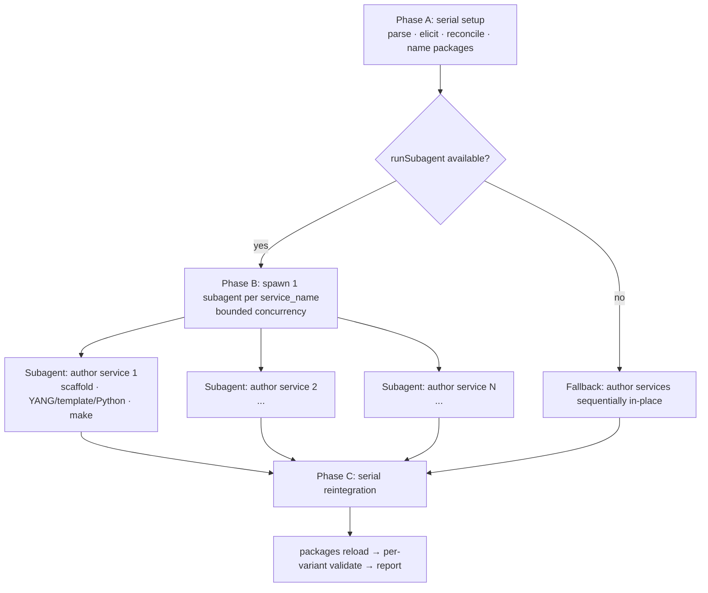

# Subagent Fan-Out — contract and rules

For large specs (many `service_name`s / variants), the orchestrator parallelizes
the **authoring** work by spawning one subagent per service. This documents the
contract, concurrency, and serialization rules.

## Why fan-out is top-level only

- Skills are passive text; only the running agent executes. The `runSubagent`
  tool belongs to the **top-level agent**.
- A subagent **cannot** spawn further subagents. If the orchestrator is nested in
  a subagent, it cannot fan out — it falls back to sequential in-place authoring.
- There is **one shared NSO runtime**. `packages reload`, CDB commits, device
  sync, service instantiation, and `load-native-config` are global and race under
  concurrency, so they are never done inside authoring subagents.

## Phase boundaries

```
Phase A (serial, once)   consult memory → parse → elicit → reconcile env → plan ids (new/modify)
Phase B (parallel)       one subagent per service_name: author files only
Phase C (serial)         single packages reload → per-variant dry-run/commit/verify → report
```



## What a subagent may and may not do

| Allowed (authoring only) | Forbidden (NSO-global) |
|---|---|
| Scaffold package(s) | `packages reload` |
| Write YANG / template / Python | CDB commit / service instantiation |
| Run `make` build | device sync / dry-run / verify |
| Return a structured result | `load-native-config` / live-NED calls |

## Subagent brief (input)

Pass exactly, scoped to one `service_name`:

- `service_name` and the list of variant `subtype`s to author
- the **concrete** rendered config per variant (placeholders already substituted
  in Phase A / Step 3)
- the key → token → value variable mapping (so tokens become YANG service leaves;
  shared → service-level, per-instance → per-endpoint)
- the assigned target package `id`(s) from `aifirst spec plan`, plus each
  variant's `NEW` / `MODIFY` decision. On `MODIFY`, edit the existing package in
  place (deep-backfill its stored spec from source first if it is a shallow
  `confidence: low` stub); never scaffold a duplicate.

> Do **not** pass secrets that were only needed for live config rendering; the
> concrete config is used for authoring, and credential values are not persisted.

## Subagent result (output)

Expect a structured summary back (the subagent returns files, never NSO state):

```
service: <service_name>
packages_authored: [<pkg-name>, ...]
per_variant:
  - subtype: <subtype>   status: authored | error   note/log: <path>
errors: [ ... ]
```

## Concurrency + isolation

- **Bounded concurrency:** default cap of **3** concurrent authoring subagents;
  do not spawn an unbounded number.
- **Failure isolation:** one service's subagent failing does not abort the rest;
  record it and continue authoring + reintegrating the others.
- **Deterministic final state:** because reintegration is serial and driven by
  the structured results, the end state does not depend on authoring order.

## Fallback (no `runSubagent`)

If fan-out is unavailable (e.g. already inside a subagent), author each service's
variants **sequentially in-place** using the same authoring-only steps, then run
the same serial Phase C reintegration. Correctness is preserved; only parallelism
is lost.
